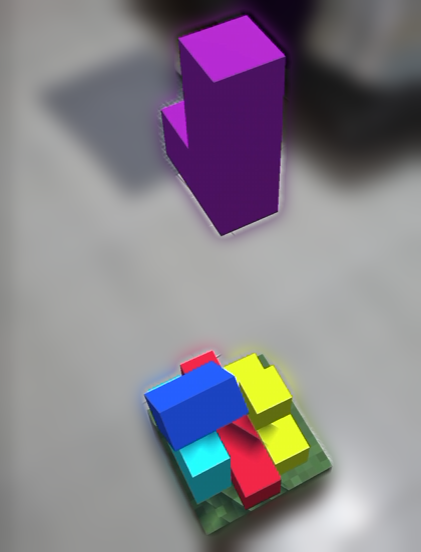

# AR Block Stacker

A mobile **augmented reality** physics stacking game built with Unity and **Vuforia Engine**. Place the play area on a real table or floor, then stack falling blocks as high as you can in 3D. Every block has physics, so an unbalanced tower will topple.

> Mixed Reality module assignment, Nanyang Polytechnic, 2021. Inspired by the 2D stacking game *Tricky Towers*, extended into 3D space with AR.

## Features

- **Ground-plane detection** (Vuforia) with a custom placement indicator (`CustomPlaneFinder`)
- Tap the indicator to place the game. Look somewhere else and tap again to move it.
- Physics-based pieces (`Blocks`, `TrickyTowers` game controller)
- Two on-screen virtual joysticks (new Input System): one rotates the piece, the other moves it

## Controls

| Input | Action |
|---|---|
| Tap the indicator | Place the game, or move it |
| Left joystick | Rotate the piece |
| Right joystick | Move the piece |

## Setup

1. Open the project in **Unity 2020.3.23f1**.
2. **Install Vuforia Engine 10.3.2.** The package file (`com.ptc.vuforia.engine-10.3.2.tgz`, about 200 MB) is not in this repo because GitHub limits file size. Download it from the [Vuforia Developer Portal](https://developer.vuforia.com/downloads/sdk) and place it in `Packages/`, or add Vuforia from the Package Manager.
3. **Add your licence key.** Create a free Basic licence on the Vuforia Developer Portal and paste it into `Assets/Resources/VuforiaConfiguration.asset` (or **Vuforia Engine → Configuration** in the editor).
4. Build to an ARCore (Android) or ARKit (iOS) device and open the `ArTricky` scene.

## Tech

Unity 2020.3 · C# · Vuforia Engine 10 (Ground Plane) · Input System
